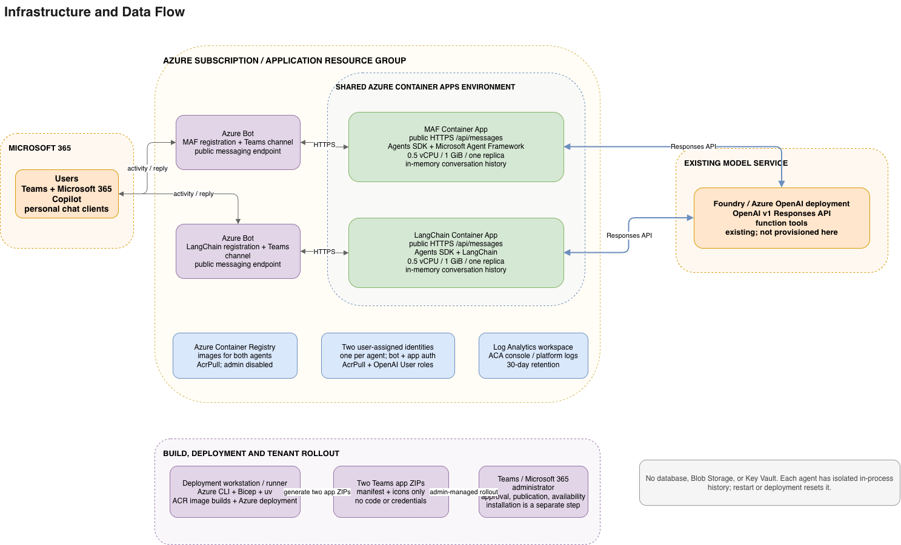

# External Python agents for Teams and Microsoft 365 Copilot

Two independently deployable assistants, implemented with **Microsoft Agent
Framework (MAF)** and **LangChain**, hosted in **Azure Container Apps (ACA)**.
Both use the **Microsoft 365 Agents SDK for Python** as their channel host.

Each has a separate container, user-assigned managed identity, Azure Bot resource,
Teams channel, and app package for both **personal Teams chat** and
**Microsoft 365 Copilot**. They share an ACA environment, registry,
and Log Analytics workspace. Model inference uses an **existing Foundry or
Azure OpenAI account and Responses API deployment**. Conversation history stays
in process memory; no Azure Storage account is required.

This is a single-tenant, text-based personal-chat development/demo baseline,
not a production-certified deployment. The packages declare **custom engine
agents** for organization-only Copilot distribution. Microsoft Graph
business-data access, user SSO, RAG, file uploads, streaming, feedback controls,
group/channel chats, and automatic Outlook exposure are not configured. Public
Agent Store certification and cross-tenant onboarding are outside this baseline.

## Architecture and data flow



The MAF and LangChain assistants are alternative implementations, not agents
that collaborate. Each has its own Container App, Azure Bot, and user-assigned
managed identity. They share the Container Apps environment, registry, and
Log Analytics workspace, and call an **existing** Foundry or Azure OpenAI
deployment. Teams and Copilot use the same bot endpoint for each assistant;
there is no separate Copilot backend.

The reply returns through the Agents SDK and Azure Bot to the originating
conversation. The read-only UTC-time tool runs inside the Python process.
Conversation history and recent-reply caches are process-local and isolated
between agents; there is no database, Blob Storage, or Key Vault in this design.
The editable source is [infrastructure-data-flow.drawio](infrastructure-data-flow.drawio).

## Repository

| Path | Purpose |
|------|---------|
| [agents/maf](agents/maf) | Self-contained MAF agent, SDK host, settings, memory, tests, and uv lockfile |
| [agents/langchain](agents/langchain) | Self-contained LangChain agent, SDK host, settings, memory, tests, and uv lockfile |
| [infra](infra) | Foundation and application Bicep templates |
| [scripts/deploy.sh](scripts/deploy.sh) | Staged deployment and Teams/Copilot packaging |
| [scripts/package_teams.py](scripts/package_teams.py) | Manifest validation and ZIP generation |
| [app-packages](app-packages) | Separate app manifest templates for Teams and Microsoft 365 Copilot |
| [infrastructure-data-flow.drawio](infrastructure-data-flow.drawio) | Editable infrastructure and data-flow diagram |
| [infrastructure-data-flow.drawio.png](infrastructure-data-flow.drawio.png) | Diagram image embedded above |
| [delete-deployment.md](delete-deployment.md) | Safe Teams and Azure decommissioning instructions |

## Prerequisites

- [uv](https://docs.astral.sh/uv/) (Python is managed by uv; projects target 3.11).
- Azure CLI, its Bicep CLI, the `containerapp` extension, jq, curl, and Bash.
  The script supports the macOS system Bash as well as Linux Bash.
- An Azure subscription, an existing **Foundry (AIServices)** or **Azure OpenAI
  (OpenAI)** account, and a deployed model supporting the Responses API and function tools.
- Azure permissions to deploy resources and create role assignments in the app
  resource group, and role-assignment permissions on the existing model account.
  Resource-group creation also requires subscription-level permission. For model
  resources in another subscription, both subscriptions must use the same tenant.
- A Teams/Microsoft 365 tenant that permits custom app installation or an
  administrator who can publish the packages.
- For Copilot use, access to Microsoft 365 Copilot Chat and tenant approval for
  custom agents. A paid Copilot add-on is not universally required; review the
  current [licensing guidance](https://learn.microsoft.com/microsoft-365/copilot/extensibility/cost-considerations)
  for the intended users and capabilities.

The model endpoint must be reachable from ACA. Private-only model endpoints
require additional network infrastructure that is not included here.

Local model calls use `AzureCliCredential`: sign in with Azure CLI and grant your
developer identity model inference access. Deployed apps use their own explicit
`ManagedIdentityCredential`; API keys and bot client secrets are not required.

### Azure components and responsibilities

| Component | Quantity | Purpose |
|---|---:|---|
| Microsoft 365 tenant | 1 | User identity, app governance, and Teams/Copilot access |
| Azure subscription and application resource group | 1 each | Resource ownership, policy, and billing |
| Foundry or Azure OpenAI account and model deployment | Existing | Responses API inference and function tools |
| Azure Container Apps environment | 1 | Shared hosting environment |
| Azure Container Apps | 2 | Separate runtime and endpoint for each assistant |
| Azure Container Registry | 1 | Stores the two independently built images |
| User-assigned managed identities | 2 | Bot authentication, image pull, and model access per agent |
| Azure Bot registrations and Teams channels | 2 each | Bot endpoints and Teams transport |
| Log Analytics workspace | 1 | ACA console and platform logs; 30-day default retention |
| Teams/Copilot app packages | 2 | Makes each bot available for tenant-approved installation |
| Deployment workstation or runner | 1 | Runs uv, Azure CLI/Bicep, image builds, and packaging |

Agree on ownership before deployment. Azure deployment permission does not imply
Teams administration permission:

- The Azure platform team approves subscription, region, resource group,
  resource types/SKUs, networking, and policy compliance.
- The deployment operator needs repository access and permission to deploy.
- An Azure RBAC administrator must be able to create the required role
  assignments. Contributor alone cannot grant those roles.
- The model owner approves deployment capability, quota, inference access, and
  data handling. The Teams/Microsoft 365 administrator handles app approval,
  publication, availability, and installation.

Each identity is granted **AcrPull** on the registry and **Cognitive Services
OpenAI User** on the existing model account. The Azure Bot registration uses the
same user-assigned identity as its Container App. Bot/channel authentication
and model authorization are separate configurations.

### Network and policy prerequisites

- Register/allow the required resource providers, including `Microsoft.App`,
  `Microsoft.ContainerRegistry`, `Microsoft.ManagedIdentity`,
  `Microsoft.OperationalInsights`, `Microsoft.BotService`, and
  `Microsoft.CognitiveServices`.
- Approve the selected region, ACA Consumption environment, ACR Basic,
  managed identities, role assignments, and Log Analytics configuration.
- Azure Bot registrations use the `global` location; an ACA region does not
  determine the residency of every service in the data path.
- Azure Bot Service must reach each app's **public HTTPS**
  `/api/messages` endpoint. The SDK validates channel tokens; do not put an
  interactive sign-in page in front of this endpoint.
- Containers need outbound connectivity to the model endpoint, Bot Service,
  and authentication dependencies. ACA must also be able to pull images.
- The build runner/ACR build process must reach image registries and Python
  package sources. The package script downloads Microsoft's Teams schema unless
  a cached schema is supplied.
- Private model endpoints, mandatory private ACR, restricted egress, or
  policy-required networking require a separately designed network setup.
  These templates do not configure VNet integration or private endpoints.

Do not weaken customer policies to make the demo work. Assess template
compatibility and agree any required changes with the platform team first.

## Local development with uv

From the repository root:

```bash
uv sync --locked
uv sync --locked --project agents/maf
uv sync --locked --project agents/langchain
cp .env.example .env
```

Edit the local `.env` with a real endpoint and deployment name. Keep
`APP_ENV=local`.

Each agent owns its hosting, settings, contracts, and conversation-memory code.
The duplication is intentional: neither agent depends on a shared local package
or the other agent. Each directory can be copied, installed, and tested independently.
The root project only provides deployment and app-packaging tooling.

```bash
# Run separately; use different ports when running both.
uv run --locked --project agents/maf teams-maf
PORT=3979 uv run --locked --project agents/langchain teams-langchain
```

Local mode binds **only to 127.0.0.1**, allows anonymous SDK activities, and keeps
conversation state in memory. Never expose this mode through a public tunnel.
Use Microsoft 365 Agents Playground against `/api/messages` for local activity
testing. Production managed identities cannot authenticate local Teams tunnels.

For VS Code debugging, choose either local agent in Run and Debug and press
**F5**. The launch configurations use each agent's uv-created virtual environment,
not the editor's potentially unrelated default interpreter.

Endpoints:

- `POST /api/messages`: SDK activity endpoint.
- `GET /health/live`: process health.
- `GET /health/ready`: initialized HTTP host readiness, with no external-service calls.
- `GET /privacy`, `GET /terms`: demo policy pages used by the Teams manifests.

Health checks do **not** prove that the model or Teams integration works.

## Deploy

Authenticate with Azure CLI for the intended tenant first. Set the deployment
inputs explicitly; the script does not source `.env` as shell code.

```bash
export AZURE_SUBSCRIPTION_ID="<subscription-id>"
export AZURE_TENANT_ID="<tenant-id>"
export AZURE_RESOURCE_GROUP="<application-resource-group>"
export AZURE_LOCATION="westeurope"
export AZURE_FOUNDRY_PROJECT_ENDPOINT="https://<foundry-account>.services.ai.azure.com/api/projects/<project-name>"
export AZURE_OPENAI_ENDPOINT="https://<foundry-account>.services.ai.azure.com/openai/v1"
export AZURE_OPENAI_DEPLOYMENT_NAME="<model-deployment-name>"
export PREFIX="teamsdemo"
export ENVIRONMENT="dev"
export IMAGE_TAG="build-001"

# Read-only Azure plan; writes only local validation artifacts.
bash scripts/deploy.sh

# Provision/build/deploy automatically, without confirmation prompts.
bash scripts/deploy.sh --apply
```

`AZURE_FOUNDRY_PROJECT_ENDPOINT` is the project endpoint shown in Microsoft
Foundry. `AZURE_OPENAI_ENDPOINT` is the OpenAI inference endpoint shown for the
same Foundry resource. The script uses the account name in the project endpoint
to resolve the parent Foundry account and its ARM ID through Azure CLI; you do
not need to copy an ARM resource ID from the Azure portal. If the model account
is in another subscription, set `AZURE_MODEL_SUBSCRIPTION_ID` to that
subscription. The model account and application subscription must use the same
tenant. No Foundry-managed agent is created.

The agents call the Foundry resource's **OpenAI v1 Responses API**, not the
Foundry project API. Export `AZURE_OPENAI_ENDPOINT` with the inference endpoint
(for example, `https://<foundry-account>.services.ai.azure.com/openai/v1/`); the
script checks that it belongs to the account in the project endpoint and
normalizes it to the resource root.
Both agents append `/openai/v1/` and call `/responses` using the OpenAI client
with an automatically refreshed Entra bearer token. Do not use an
`/api/projects/...` endpoint.
`AZURE_OPENAI_DEPLOYMENT_NAME` is the deployed model's name, not the project name
or catalog model ID. The v1 API does not need `AZURE_OPENAI_API_VERSION`; that
legacy setting is no longer used or deployed.

Both clients explicitly send `store=false` and replay messages locally rather
than depending on server-side response IDs. Encrypted reasoning items are
carried through each tool loop so reasoning and function calls work together.
Only text history is retained across user turns. This does not change the model
service's applicable data-handling policies.

The script:

1. Checks tools, login/tenant, the existing model account, and deployment.
2. Compiles both Bicep entrypoints and shows foundation what-if.
3. With `--apply`, creates the resource group if needed and deploys
   registry, environment, identities, logs, and RBAC.
4. Builds both Linux/amd64 images in ACR using **uv lockfiles**.
   A local Docker daemon is not required.
5. Resolves images to immutable digests and shows application what-if.
6. With `--apply`, deploys ACA apps, Azure Bots, and Teams channels without prompting.
7. Checks readiness and verifies anonymous messaging requests get HTTP 401.
8. Validates each manifest against Microsoft's pinned 1.22 schema and checks
   bot/agent ID and scope consistency, then generates dual-surface ZIPs with the
   manifest and original M/L demo icons. The default app package version is 1.1.0.

For a new resource group, cloud what-if cannot run before the group exists.
Plan-only mode reports that limitation without creating the group. Foundation
what-if runs once the group is created during an explicit `--apply` run. Application
what-if needs foundation outputs and image digests, so runs after the build stage.
For an existing foundation, `--images-json <file>` also enables read-only
application what-if without `--apply`.

Use `--agent maf` or `--agent langchain` to deploy only one application. The shared
foundation always defines both identities; application
deployment is incremental and does not delete the other agent.

Use a **new image tag for each build**. Existing tags are not overwritten.
`--apply` runs resource writes, builds, and application changes automatically,
without confirmation prompts, including in CI. The scope summary and what-if
output remain informational; they do not pause the deployment. Review a
plan-only run first if needed. `--yes` remains accepted alongside `--apply` for
compatibility but is unnecessary. Without `--apply`, the script never writes
Azure resources.

Output is under `dist/<prefix>-<environment>/`:

- `foundation.json`, `applications.json`: non-secret Bicep outputs.
- `images.json`: current digest images.
- `previous-images.json`: images before the latest application update.
- `applications.parameters.json`: reproducible application parameters.
- `maf-teams.zip`, `langchain-teams.zip`: installable Teams/Copilot packages.
  Existing filenames are preserved; each ZIP supports both surfaces.

Do not run deployments for different subscriptions/resource groups with the same
prefix/environment concurrently from the same checkout: they share a local output
directory. Save output artifacts externally before replacing a checkout.

### Teams app package contents and identifiers

Each generated ZIP contains only three root-level files:

| File | Purpose |
|---|---|
| `manifest.json` | App metadata, bot ID, Teams/Copilot scopes, custom engine declaration, conversation starters, domains, and policy URLs |
| `color.png` | Full-color app icon |
| `outline.png` | Outline app icon |

Python code and credentials stay in Azure; they are not included in the package.
Each manifest contains one custom engine agent. Schema version 1.22 supports
the Copilot declaration, and the default package version is **1.1.0**. The
custom engine agent ID is the bot client ID, not the top-level manifest app ID.

Keep these identifiers distinct:

- **Manifest app ID:** stable app identity used to package and update the app.
- **Bot ID:** the user-assigned identity's client ID; referenced by the manifest.
- **Managed identity principal ID:** used for Azure RBAC assignments.
- **Catalog-generated app ID:** assigned by the tenant catalog and used in
  catalog updates and user installation operations.

Azure Bot stores the actual messaging endpoint,
`https://<container-app-fqdn>/api/messages`; it is not directly configured in
the manifest. Before customer distribution, replace the demo branding and
developer details in [the manifest templates](app-packages), and replace the demo
privacy/terms responses in the [MAF host](agents/maf/src/maf_agent/host.py)
and [LangChain host](agents/langchain/src/langchain_agent/host.py).
Regenerate the packages after making those changes.

### Existing images and rollback

Provide a JSON object with selected agents and fully qualified digest images:

```json
{
  "maf": "yourregistry.azurecr.io/maf@sha256:<64-hex-digest>",
  "langchain": "yourregistry.azurecr.io/langchain@sha256:<64-hex-digest>"
}
```

Deploy an existing image without rebuilding:

```bash
bash scripts/deploy.sh --agent maf --images-json ./saved-images.json --apply
```

For rollback, **copy the previous-images file to a separate path first**, then use
that copy with `--images-json`. The script replaces the previous-images file during
each application update. Rollback restores images, not conversation history,
infrastructure, or model settings. Preserve an older parameters file if those
settings must also be restored.

### Install in Teams

The script deliberately does **not** publish tenant apps.

1. For developer testing, a pilot user can upload each ZIP through
   **Apps > Manage your apps > Upload an app > Upload a custom app** when tenant
   policy permits. Select **Add** to install the personal app.
2. For organization-managed publication, use **Teams admin center > Teams apps >
   Manage apps**. Upload a new ZIP only for the first publication. For an
   existing app, update it from its details page with a higher package version;
   do not create a duplicate app ID.
3. Review the app, ensure it is allowed, and assign the approved pilot audience.
   Configure installation through **Edit installs** or **Users and groups >
   Installs**, as available. Pinning through Teams setup policies is optional.
   Availability, installation, and pinning are separate actions.
4. Complete any required approval or consent through an authorized
   administrator; do not weaken tenant policies to bypass approval.
5. Send a message to each agent and ask for the current UTC time.
6. Send a follow-up and verify retained context.
7. Restart/roll out an ACA revision and verify context resets as expected.

Teams app IDs are deterministic per subscription/resource group/prefix/environment/
agent and remain stable between package builds. Bot IDs are the respective
managed identity client IDs. These are deliberately different identifiers.
Increase `--app-version`, for example `--app-version 1.1.1`, when updating a package.
The default 1.1.0 introduces Copilot support; use a higher value if your installed
package already has that version or later.

### Publish in Microsoft 365 Copilot

Keep this integration in the same repository: both surfaces use the same SDK
host, bot registration, identity, and deployed agent. No additional Azure
resources, bot secrets, or runtime Microsoft Graph permissions are required.
Tenant publication uses separate administrator permissions.

Each manifest keeps personal Teams chat and adds the `copilot` scope, a
`copilotAgents.customEngineAgents` entry pointing to its existing bot client ID,
three conversation starters, and an AI disclaimer. The app IDs remain unchanged.

1. Generate the versioned ZIPs through the normal deployment or package-only
   workflow. Do not upload old ZIPs from an earlier release.
2. Open **Microsoft 365 admin center > Settings > Integrated apps** and check
   **Available Apps** for the exact app. If it was already published through
   Teams admin center, deploy that existing entry; **do not upload it again**.
   Verify that the entry has the intended Copilot-enabled package version.
3. For a first publication that does not already exist, an alternative is
   **Upload custom apps > Teams App** in Integrated apps. Upload the generated
   ZIP and verify the recognized host products include Microsoft 365 Copilot.
   These are alternative publication routes, not two required uploads.
4. For an admin-managed rollout, review permissions, select **Just me** or an
   approved pilot group, obtain any required consent, and choose **Finish
   deployment**. Review availability separately: custom uploads can be available
   organization-wide by default, even when preinstallation targets a small group.
5. After catalog/policy propagation, open or install each agent in Copilot as
   permitted by tenant policy. Test normal prompts, the UTC time tool, and
   follow-up context.
6. Verify personal Teams installation and chat independently before expanding
   availability. The documented Integrated apps preinstallation flow targets
   Copilot/Outlook, not Teams; it is not proof of a Teams user installation.

Admin preinstallation is a rollout option, not a universal requirement where
self-installation is permitted. Pinning is separate and optional. Unified app
management can synchronize availability/status; it does not establish a
universal requirement for two uploads or two admin installations.

Teams sideloading, where allowed, can be used for developer testing. It does
not publish an agent to the organization's Agent Store. Do not publish duplicate
catalog entries for the same app identity. For Copilot, see
[Microsoft's cross-application app instructions](https://learn.microsoft.com/en-us/microsoft-365/admin/manage/teams-apps-work-on-outlook-and-m365?view=o365-worldwide#upload-custom-cross-application-apps).

For an existing deployment, Copilot routing itself is a package update; it does
not require rebuilding either framework. A package-only example is:

```bash
uv run --locked scripts/package_teams.py \
  --agent maf \
  --bot-id "<existing-maf-bot-client-id>" \
  --domain "<existing-maf-container-app-hostname>" \
  --subscription "<same-subscription-id>" \
  --resource-group "<same-application-resource-group>" \
  --prefix "<same-prefix>" --environment "<same-environment>" \
  --version 1.1.1 --output dist/copilot
```

Repeat for `langchain` with its own bot ID and hostname. Use the **same**
subscription/resource group/prefix/environment as the original deployment so
the deterministic app ID stays unchanged, and a version greater than the
installed package. Deploy new images separately to pick up updated assistant
wording, the welcome message, and the privacy disclosure.

Catalog availability does not replace backend authorization. The runtime
remains single-tenant, and Teams and Copilot chats do not automatically share
conversation history. Copilot publication does not grant Microsoft 365 file
access or make these tools available in every default Copilot conversation.

These packages target an internal pilot, not a public marketplace listing.
Streaming, feedback, source citations, and supported cross-tenant onboarding
need additional work for public distribution; see [the extension design](extend.md).
Real tenant discovery and a signed Copilot-to-model round trip must be verified
in your tenant; local tests do not prove either.

#### Teams and Copilot tenant publication details

Teams and Copilot use the same generated ZIP, manifest app ID, bot ID, and Azure
backend. Publication, user availability, installation/preinstallation, and
pinning are distinct actions. A successful upload does not guarantee that the
app is installed for every user or available in every host.

For Copilot, first check **Microsoft 365 admin center > Settings > Integrated
apps > Available Apps** for the exact app and package version. If it is already
listed from Teams admin center publication, deploy that existing entry; update
the catalog version first if needed. Only use **Upload custom apps > Teams App**
when publishing a new app that is not already available. Confirm Microsoft 365
Copilot is among the recognized host products. An admin-managed rollout can
target **Just me** or an approved pilot group, but review availability settings
separately: organization-wide self-install availability may not be restricted
by a small preinstallation audience. Allow for policy propagation and validate
Copilot and Teams separately. Pinning is optional.

For tenants on unified app management, app availability/status changes
synchronize between Teams admin center and Integrated apps. Otherwise, the app
may need to be allowed in both admin centers. In either case, verify the actual
package version, availability, and user installation rather than inferring one
from another. The documented Integrated apps preinstallation flow targets
Copilot/Outlook, not Teams; Outlook remains outside this repository's validation
scope.

Microsoft Graph publication is an optional, separate tenant-administration
workflow and is **not implemented here**:

| Operation | Graph API |
|---|---|
| Publish to the tenant catalog | `POST /v1.0/appCatalogs/teamsApps` with the ZIP |
| Publish an updated version | `POST /v1.0/appCatalogs/teamsApps/{catalog-app-id}/appDefinitions` |
| Install personally for a user | `POST /v1.0/users/{user-id}/teamwork/installedApps` |

Catalog publication/update uses delegated authentication as documented by
Microsoft; a submission workflow can use `AppCatalog.Submit`, while direct
publication requires appropriate administrator privileges and delegated
permissions such as `AppCatalog.ReadWrite.All`. User installation can use
application permissions with administrator consent, such as
`TeamsAppInstallation.ReadWriteForUser.All` for a separate rollout application.
Use least privilege and an explicit pilot audience. These permissions do not
bypass approval or availability policies and must not be added to the runtime
bot identities.

### Validate and troubleshoot the complete user journey

Run the following checks independently for both agents:

| Check | Expected result |
|---|---|
| ACA revision health | Running revision and successful startup/readiness probes |
| `/health/live` and `/health/ready` | HTTP 200; neither endpoint contacts the model |
| Anonymous `POST /api/messages` | HTTP 401 |
| Install in the intended tenant | Personal app opens without policy errors |
| Open in Microsoft 365 Copilot | Agent is available to assigned pilot users after approval and propagation |
| Send a normal message in Teams and Copilot | Model-generated reply returns to the originating chat in both surfaces |
| Ask for the current UTC time | Tool executes and a useful response returns |
| Ask the agent to recall a preference | Context is retained within that running process |
| Test another user and the other agent | Histories remain isolated |
| Restart or deploy a revision | In-process history and recent-reply caches reset |

Health checks, a welcome message, and HTTP 200 activity acknowledgements do not
prove model success. Verify a complete message-to-model-to-client reply and an
actual tool invocation. Confirm authenticated Copilot activities preserve the
configured tenant boundary; do not relax authentication to make testing succeed.
Offline tests do not verify tenant discovery or a signed Copilot round trip.

| Symptom | First checks |
|---|---|
| App cannot be uploaded or found | ZIP validation, catalog status, tenant policy, assigned audience, and propagation |
| Works in Teams but is absent in Copilot | Package version, Copilot scope/declaration, recognized host products, policies, audience, and propagation |
| Teams message never reaches the app | Teams channel, manifest bot ID, Bot endpoint, and public HTTPS ingress |
| Channel authentication fails | Tenant, bot identity client ID, attached managed identity, and SDK configuration |
| Model returns 401/403 | Model endpoint, runtime identity, model RBAC, network restrictions, and role-assignment propagation |
| Model returns 400 | Deployment supports Responses API and function tools; deployed image is current |
| Readiness hangs or fails | ACA revision startup, ingress, port 3978, probes, and console logs |
| Context disappears | Restart/deployment reset is expected; verify the app still has exactly one replica |

For an installed Copilot agent that does not reply, first test the same agent
in Teams. If Teams works, investigate Copilot activation, package identity and
version, tenant policy, and Bot Service routing before changing the model or
authentication. Compare the arrival logs for one message from each client:

- Each agent's host logs `Messaging request received` before SDK authentication
  and `Messaging request completed` with status and duration afterwards. It
  does not log request bodies, authorization headers, query strings, or
  conversation/user IDs.
- Teams arrival without Copilot arrival points to Copilot installation,
  activation, policy, or Bot Service routing; it is not evidence of model failure.
- HTTP 401/403 means the request arrived but was rejected. Check channel
  authentication and identity; do not enable anonymous Azure mode.
- HTTP 2xx without a message activity means inspect activity type and SDK
  dispatch; an HTTP acknowledgement is not a successful agent reply.
- A message activity followed by an error reference points to the host/model
  exception or reply delivery error associated with that reference.

`STDERR` describes an output stream, not severity. The current host sends INFO
to stdout and WARNING/ERROR to stderr; older images may send INFO to stderr too.
Use explicit log level and status, and do not share tokens, prompts, or sensitive
conversation identifiers in support tickets.

### Updating an existing Chat Completions deployment

Build and deploy **both** agents with a new `IMAGE_TAG`; old image digests keep
the previous API behavior. This fixes models that reject reasoning plus
function tools on Chat Completions, such as the observed `gpt-6.1-sol` HTTP 400.
The model deployment must support Responses and function tools. The Teams
app IDs, bot registrations, and messaging endpoints do not change, so this
backend-only update does not require reinstalling the Teams packages.
Health checks do not call the model; send a Teams message and a tool request
after deploying to verify live model compatibility.

## Conversation memory and safety

- Conversation history is held in each agent process's memory, both locally and
  in Azure. No Blob client, storage account, storage RBAC, or storage settings are
  required.
- Keys partition by agent, tenant, channel, conversation, and user.
- Process-local locks serialize concurrent turns for the same conversation.
- The last 10 text turns and last 20 activity replies are retained per conversation.
  All history and cached replies reset on restart, deployment, or rollback.
  There is no time-based expiry or global conversation-count limit in this demo;
  monitor memory use before extending it to many users.
- Cached replies avoid repeated model/tool calls for recent duplicate activities.
  Delivery is **at least once**, not exactly once: a duplicate request can resend
  the same answer, and retries after restart or cache eviction can call the model again.
- The SDK's in-memory `TurnState` contains no conversation history; each agent's
  own in-memory conversation store is its history source.
- Bicep fixes both minimum and maximum replicas to **1** and uses single-revision
  mode. Do not enable horizontal scaling without introducing shared state.
  Single-revision deployments may temporarily overlap processes; memory and
  duplicate-reply caches are not shared across that rollout.
- Model execution is limited to 25 seconds, input to 8000 characters, and replies
  to 3500 characters. Only a read-only UTC time tool is provided.
- Production messaging requires validated channel tokens, issuer validation,
  and the configured tenant for Teams messages.
- HTTP probes remain unauthenticated and contain no conversation content.
- Request bodies and model prompts are not deliberately logged. Exceptions and
  operation metadata go to ACA console logs/Log Analytics; treat logs as sensitive.
- Messaging request arrival, HTTP status, duration, and a generated reference are
  logged before/after channel authentication. Accepted message activities also
  log the channel name, not message content. Probes are excluded. INFO logs go
  to stdout; WARNING/ERROR logs go to stderr. Older images send INFO to stderr
  too: a `STDERR` label alone does not mean an operation failed.

One warm replica per agent reduces cold starts but costs more than scale-to-zero.
Defaults are 0.5 vCPU/1 GiB per replica, exactly 1 replica per app, ACR Basic,
and 30-day log retention. No exact cost estimate is included: region, uptime,
replicas, log volume, and model token usage determine the bill.

## Tests and validation

```bash
uv run --locked ruff check .
uv run --locked ruff format --check .
uv run --locked pyright
uv run --locked pyright --project agents/maf
uv run --locked pyright --project agents/langchain
uv run --locked pytest tests
uv run --locked --project agents/maf pytest agents/maf/tests
uv run --locked --project agents/langchain pytest agents/langchain/tests

az bicep build --file infra/foundation.bicep --stdout > /dev/null
az bicep build --file infra/applications.bicep --stdout > /dev/null
bash -n scripts/deploy.sh
```

Tests include real framework tool loops with mocked model transports, SDK
authentication/probes, in-memory history/reset/concurrency, packaging shapes, and
deployment-script dry-run/selection safeguards with a mocked Azure CLI.
They do not call a live model or tenant.

Host, authentication, and conversation-memory tests live in each agent's own
test suite. Container builds also use only that agent's directory as their build
context, with its own `.dockerignore`:

```bash
docker build -t teams-maf-agent agents/maf
docker build -t teams-langchain-agent agents/langchain
```

Packaging tests use a cached copy of the
[official 1.22 schema](https://developer.microsoft.com/en-us/json-schemas/teams/v1.22/MicrosoftTeams.schema.json)
at [tests/fixtures/MicrosoftTeams.v1.22.schema.json](tests/fixtures/MicrosoftTeams.v1.22.schema.json),
retrieved on 2026-10-21, so tests do not require network access. They validate
both Copilot-enabled manifests and reject inconsistent IDs/scopes.

Run the commands above after changes. Unit tests mock external services and do
not prove live model or Teams connectivity.

For a manual package-only operation, run `uv run --locked
scripts/package_teams.py --help`. Schema download failure is an error, not a skipped
validation. Use `--schema <cached-official-schema.json>` when working offline.

## Remaining validation and limitations

- Actual Azure provisioning, managed-identity token acquisition, ACR image builds,
  and a real Teams/model round trip require your deployment inputs and permissions.
- Review demo privacy/terms/developer details before distributing beyond test users.
- Azure Bot resources are global; verify your data-residency requirements.
- No new model account/deployment is provisioned by these templates.
- No Key Vault is needed for the current secret-free design.
- Observability is console logs plus Log Analytics; Application Insights tracing,
  CI/CD, private networking, alerts, and production load testing are future work.
- Before a broader rollout, agree supported load and availability, network
  architecture, state/retention requirements, content safety, authorization for
  future tools, budgets, monitoring/alerts, incident response, CI/CD, dependency
  updates, and an accountable service owner.
- HTTP/model errors return safe user-visible messages with correlation references.
  Do not regard HTTP 200 activity acknowledgement as proof of model success.

## Cleanup

Stop local hosts with Ctrl+C. To remove a cloud environment, review the dedicated
resource group, then delete it explicitly in the Azure portal. Also remove the
Teams apps and the two role assignments on the **existing model account**, which
is outside the app resource group. Deleting the app resource group does not delete
that model account or automatically guarantee cleanup of cross-scope assignments.
The deployment script never performs resource deletion.

For publication-only removal or a full teardown with ownership checks, follow
[the cleanup guide](delete-deployment.md). Removing Teams/Copilot apps does not
delete the Azure backend.

### Updating an existing Blob-backed deployment

Build new images with a **new `IMAGE_TAG`** and deploy both agents using the usual
`bash scripts/deploy.sh --apply` flow. Reusing the old image digests will retain
the Blob-dependent runtime. The new foundation/application templates no longer
create or reference storage, and readiness no longer checks Blob access.

Deployments are incremental: the existing storage account, containers, and
storage role assignments are **not deleted**. They are unused once both updated
agents run. Review and remove them separately if appropriate for your policies;
old conversation data is not migrated into memory. Do not loosen storage
network restrictions for this update.

## Further reading

- [Microsoft 365 Agents SDK for Python quickstart](https://learn.microsoft.com/en-us/microsoft-365/agents-sdk/quickstart?pivots=python)
- [Azure Bot with a user-assigned managed identity](https://learn.microsoft.com/en-us/microsoft-365/agents-sdk/azure-bot-create-managed-identity)
- [Foundry model endpoints](https://learn.microsoft.com/en-us/azure/ai-foundry/foundry-models/concepts/endpoints?view=foundry-classic)
- [Upload a custom Teams app](https://learn.microsoft.com/en-us/microsoftteams/platform/concepts/deploy-and-publish/apps-upload)
- [Manage organization custom Teams apps](https://learn.microsoft.com/en-us/microsoftteams/teams-custom-app-policies-and-settings)
- [Deploy custom cross-application apps through Integrated apps](https://learn.microsoft.com/en-us/microsoft-365/admin/manage/teams-apps-work-on-outlook-and-m365?view=o365-worldwide#upload-custom-cross-application-apps)
- [Copilot extensibility licensing and costs](https://learn.microsoft.com/microsoft-365/copilot/extensibility/cost-considerations)
- [Graph: publish a Teams app](https://learn.microsoft.com/en-us/graph/api/teamsapp-publish?view=graph-rest-1.0)
- [Graph: update a Teams app](https://learn.microsoft.com/en-us/graph/api/teamsapp-update?view=graph-rest-1.0)
- [Graph: install an app for a user](https://learn.microsoft.com/en-us/graph/api/userteamwork-post-installedapps?view=graph-rest-1.0)
